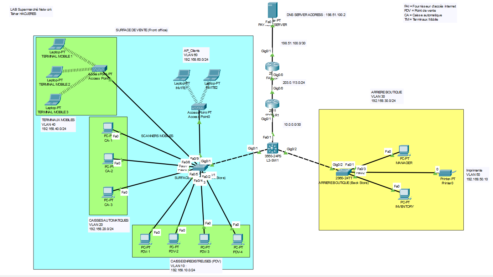

# 🛒 Réseau d'un supermarche : Cisco Packet Tracer

Lab de conception et de sécurisation du réseau d'un supermarché : segmentation par VLAN, routage inter-VLAN sur switch L3, DHCP, NAT/PAT, DNS, isolation du Wi-Fi invité et durcissement des équipements.

   

---

## 📑 Sommaire

1. [Objectif](#-objectif)
2. [Schéma réseau](#-schéma-réseau)
3. [Plan d'adressage](#-plan-dadressage)
4. [Configuration clé](#-configuration-clé)
5. [Sécurité mise en place](#-sécurité-mise-en-place)
6. [Exemple de flux](#-exemple-de-flux--une-caisse-contacte-le-serveur-de-paiement)
7. [Tests et validation](#-tests-et-validation)
8. [Limites connues](#-limites-connues)
9. [Pistes d'amélioration](#-pistes-damélioration)
10. [Ce que j'ai appris](#-ce-que-jai-appris)
11. [Compétences démontrées](#-compétences-démontrées)

---

## 🎯 Objectif

Simuler le réseau d'un supermarché composé de :

- une **surface de vente** : caisses enregistreuses, caisses automatiques, terminaux mobiles, Wi-Fi invité ;
- une **arrière-boutique** : postes de gestion et imprimante ;
- un **routeur de bordure** relié à Internet ;
- un **serveur de paiement** hébergé chez un fournisseur d'accès (FAI) simulé.

Objectifs techniques :

- Segmenter le réseau par usage grâce aux **VLANs**.
- Assurer le **routage inter-VLAN** et le **DHCP** depuis un switch de niveau 3.
- Donner un accès Internet à tout le réseau interne avec **une seule adresse publique (NAT/PAT)**.
- **Isoler le Wi-Fi invité** du réseau interne.
- **Durcir** les équipements : port-security, BPDU Guard, ports inutilisés désactivés, SSH, mots de passe chiffrés.
- Permettre aux caisses de joindre le serveur de paiement **par son nom** (`payment.store.com`).

### Fiche rapide

| Élément | Détail |
| --- | --- |
| Outil | Cisco Packet Tracer |
| Équipements | 2 routeurs (2911), 1 switch multicouche, 2 switches d'accès, 1 serveur |
| VLANs | 7 VLANs actifs (10, 20, 30, 40, 50, 60, 99) + VLAN 999 pour les ports inutilisés |
| Services | DHCP (5 pools), NAT/PAT, DNS, routage statique, SSH |
| Sécurité | ACL invités, port-security, BPDU Guard, shutdown des ports libres, chiffrement des mots de passe, bannière légale |
| Domaine | `store.local` |

---

## 🗺️ Schéma réseau

> 💡 .

### Équipements

| Hostname | Modèle | Rôle |
| --- | --- | --- |
| FAI-ISP_R1 | Routeur Cisco 2911 | Simule le FAI : relie EDGE-R1 et le serveur de paiement |
| EDGE-R1 | Routeur Cisco 2911 | Routeur de bordure : NAT/PAT et sortie vers le FAI |
| L3-SW1 | Switch multicouche | Cœur de réseau : routage inter-VLAN, DHCP, ACL invités |
| SURFACE-DE-VENTE | Switch d'accès | Caisses, caisses automatiques, bornes Wi-Fi mobiles et invités |
| ARRIERE-BOUTIQUE | Switch d'accès | PC de l'arrière-boutique et imprimante |
| PAYMENT SERVER | Serveur | Serveur de paiement et DNS (`payment.store.com`) |

### Liaisons

| Équipement A | Interface | Équipement B | Interface | Réseau / VLANs |
| --- | --- | --- | --- | --- |
| FAI-ISP_R1 | Gi0/0 | EDGE-R1 | Gi0/0 | 203.0.113.0/24 |
| FAI-ISP_R1 | Gi0/1 | PAYMENT SERVER | Fa0 | 198.51.100.0/30 |
| EDGE-R1 | Gi0/1 | L3-SW1 | Fa0/1 (routé) | 10.0.0.0/30 |
| L3-SW1 | Gi0/1 (trunk) | SURFACE-DE-VENTE | Gi0/1 (trunk) | VLAN 10, 20, 40, 60, 99 |
| L3-SW1 | Gi0/2 (trunk) | ARRIERE-BOUTIQUE | Gi0/2 | VLAN 30, 50, 99 |

---

## 📐 Plan d'adressage

### Liaisons routées

| Équipement | Interface | Adresse | Remarque |
| --- | --- | --- | --- |
| FAI-ISP_R1 | Gi0/0 | 203.0.113.1/24 | Côté Internet vers EDGE-R1 |
| FAI-ISP_R1 | Gi0/1 | 198.51.100.1/30 | Passerelle du serveur de paiement |
| PAYMENT SERVER | Fa0 | 198.51.100.2/30 | Serveur DNS + enregistrement A |
| EDGE-R1 | Gi0/0 | 203.0.113.2/24 | `ip nat outside` |
| EDGE-R1 | Gi0/1 | 10.0.0.1/30 | `ip nat inside` |
| L3-SW1 | Fa0/1 | 10.0.0.2/30 | Port routé (`no switchport`) |

### VLANs du réseau interne

| VLAN | Usage | Réseau | Passerelle | DHCP | Ports |
| --- | --- | --- | --- | --- | --- |
| 10 | PDV (caisses enregistreuses) | 192.168.10.0/24 | 192.168.10.1 | Oui | SURFACE Fa0/1 à 0/4 |
| 20 | Caisses automatiques | 192.168.20.0/24 | 192.168.20.1 | Oui | SURFACE Fa0/5 à 0/7 |
| 30 | Arrière-boutique | 192.168.30.0/24 | 192.168.30.1 | Oui | ARRIERE Fa0/1 et Fa0/2 |
| 40 | Terminaux mobiles | 192.168.40.0/24 | 192.168.40.1 | Oui | SURFACE Fa0/8 (borne Wi-Fi) |
| 50 | Imprimante | 192.168.50.0/24 | 192.168.50.1 | Non (statique) | ARRIERE Fa0/3 |
| 60 | Wi-Fi invité | 192.168.60.0/24 | 192.168.60.1 | Oui + ACL | SURFACE Fa0/9 (borne Wi-Fi) |
| 99 | Management | 192.168.99.0/24 | 192.168.99.1 | Non (statique) | SVI des switches |
| 999 | Ports inutilisés | n/a | n/a | n/a | Ports en shutdown |

Sur les VLANs 10, 20, 30, 40 et 60, les adresses `.1` à `.20` sont exclues du DHCP (réservées aux équipements fixes). Les clients reçoivent le DNS `198.51.100.2`.

### Management (VLAN 99)

| Équipement | Adresse | Passerelle |
| --- | --- | --- |
| L3-SW1 | 192.168.99.1/24 | n/a (c'est la passerelle) |
| SURFACE-DE-VENTE | 192.168.99.2/24 | 192.168.99.1 |
| ARRIERE-BOUTIQUE | 192.168.99.3/24 | 192.168.99.1 |

---

## ⚙️ Configuration clé

### NAT/PAT sur EDGE-R1

```
ip nat inside source list 1 interface GigabitEthernet0/0 overload
access-list 1 permit 192.168.0.0 0.0.255.255
ip route 0.0.0.0 0.0.0.0 203.0.113.1
ip route 192.168.0.0 255.255.0.0 10.0.0.2
```

Le PAT permet à tout le réseau `192.168.0.0/16` de sortir avec l'unique adresse `203.0.113.2`.

### Pools DHCP sur L3-SW1

| Pool | Réseau | Passerelle | DNS |
| --- | --- | --- | --- |
| PDV | 192.168.10.0/24 | 192.168.10.1 | 198.51.100.2 |
| CAISSE-AUTOMATIQUE | 192.168.20.0/24 | 192.168.20.1 | 198.51.100.2 |
| ARRIERE-BOUTIQUE | 192.168.30.0/24 | 192.168.30.1 | 198.51.100.2 |
| TERMINAUX-MOBILE | 192.168.40.0/24 | 192.168.40.1 | 198.51.100.2 |
| INVITE-WIFI | 192.168.60.0/24 | 192.168.60.1 | 198.51.100.2 |

### ACL du Wi-Fi invité (en entrée sur Vlan60)

```
ip access-list extended FILTRE-INVITE
 permit udp any eq bootpc any eq bootps
 deny ip 192.168.60.0 0.0.0.255 192.168.0.0 0.0.255.255
 permit ip 192.168.60.0 0.0.0.255 any
```

1. La première ligne laisse passer le DHCP (sans elle, le `deny` implicite empêche les invités d'obtenir une adresse).
2. La deuxième interdit l'accès au réseau interne.
3. La troisième autorise le reste, donc Internet.

### Ports des switches d'accès

**SURFACE-DE-VENTE**

| Port | Usage | VLAN | Protections |
| --- | --- | --- | --- |
| Fa0/1 à Fa0/4 | Caisses enregistreuses | 10 | Port-security sticky, PortFast, BPDU Guard |
| Fa0/5 à Fa0/7 | Caisses automatiques | 20 | Port-security sticky, PortFast, BPDU Guard |
| Fa0/8 | Borne Wi-Fi mobiles | 40 | Port-security (max 2), PortFast, BPDU Guard |
| Fa0/9 | Borne Wi-Fi invités | 60 | PortFast, BPDU Guard |
| Fa0/10 à Fa0/24, Gi0/2 | Inutilisés | 999 | Shutdown |
| Gi0/1 | Trunk vers L3-SW1 | 10, 20, 40, 60, 99 | VLANs autorisés limités |

**ARRIERE-BOUTIQUE**

| Port | Usage | VLAN | Protections |
| --- | --- | --- | --- |
| Fa0/1 | PC Manager | 30 | PortFast, BPDU Guard |
| Fa0/2 | PC Inventaire | 30 | PortFast, BPDU Guard |
| Fa0/3 | Imprimante | 50 | PortFast, BPDU Guard |
| Fa0/4 à Fa0/24, Gi0/1 | Inutilisés | 999 | Shutdown |
| Gi0/2 | Liaison vers L3-SW1 | n/a | Aucune configuration explicite (voir limites) |

### Serveur de paiement

- Adressage statique : passerelle `198.51.100.1`, DNS `198.51.100.2` (lui-même).
- Service DNS avec un enregistrement A : `payment.store.com → 198.51.100.2`.

---

## 🔒 Sécurité mise en place

| Mesure | Où | Effet |
| --- | --- | --- |
| Segmentation VLAN | Tout le réseau interne | Sépare les usages (caisses, mobiles, invités, management) |
| ACL `FILTRE-INVITE` | L3-SW1, Vlan60 | Empêche les invités d'atteindre `192.168.0.0/16` |
| Port-security (sticky) | SURFACE Fa0/1 à 0/8 | Lie chaque port aux adresses MAC autorisées |
| BPDU Guard + PortFast | Ports d'accès | Coupe un port si un switch non autorisé est branché |
| Ports inutilisés en shutdown + VLAN 999 | Tous les switches | Réduit la surface d'attaque physique |
| VLANs autorisés sur les trunks | L3-SW1, switches d'accès | Limite les VLANs transportés au strict nécessaire |
| SSH seul sur les VTY, login local | Les 3 switches | Pas de Telnet, authentification locale |
| `enable secret` + `service password-encryption` | Switches | Mots de passe stockés chiffrés |
| Bannière légale | Les 3 switches | Avertissement « AUTHORIZED ACCESS ONLY » |
| VLAN 1 désactivé | Les 3 switches | SVI VLAN 1 en shutdown, sans adresse |
| NAT/PAT | EDGE-R1 | Masque les adresses internes derrière une adresse publique |

> 🔐 Les mots de passe sont dans le fichier documentation_reseau.docx.

---

## 🔄 Exemple de flux : une caisse contacte le serveur de paiement

1. La caisse (VLAN 10) obtient son adresse `192.168.10.x` et le DNS `198.51.100.2` par DHCP (L3-SW1).
2. Elle résout `payment.store.com` auprès du serveur DNS, qui répond `198.51.100.2`.
3. Le trafic part vers sa passerelle `192.168.10.1` (L3-SW1), puis suit la route par défaut jusqu'à EDGE-R1 (`10.0.0.1`).
4. EDGE-R1 remplace l'adresse source par `203.0.113.2` (PAT) et envoie vers le FAI (`203.0.113.1`).
5. Le FAI transmet vers `198.51.100.2`. La réponse suit le chemin inverse grâce à la table NAT.

### Matrice des flux (état actuel)

| Source | Internet | Autres VLANs | Serveur paiement | Management (99) |
| --- | --- | --- | --- | --- |
| VLAN 10, 20, 30, 40, 50 | ✅ | ✅ (non filtré) | ✅ | ✅ (non filtré) |
| VLAN 60 (invités) | ✅ | ❌ (ACL) | ✅ (à corriger) | ❌ (ACL) |

---

## ✅ Tests et validation

| N° | Test | Où | Résultat attendu |
| --- | --- | --- | --- |
| 1 | `show vlan brief` | Les 3 switches | VLANs créés, ports dans les bons VLANs |
| 2 | `show interfaces trunk` | L3-SW1 | Gi0/1 et Gi0/2 en trunk avec les bons VLANs |
| 3 | Renouveler l'IP | PC caisse (VLAN 10) | Adresse `192.168.10.21` ou plus, passerelle `.1`, DNS `198.51.100.2` |
| 4 | `show ip dhcp binding` | L3-SW1 | Baux visibles pour chaque VLAN avec DHCP |
| 5 | `ping 192.168.20.1` | PC caisse (VLAN 10) | Réponse : routage inter-VLAN fonctionnel |
| 6 | `ping 203.0.113.1` | PC caisse (VLAN 10) | Réponse : sortie Internet via NAT |
| 7 | `show ip nat translations` | EDGE-R1 | Adresses `192.168.x.x` traduites en `203.0.113.2` |
| 8 | `ping payment.store.com` | PC caisse (VLAN 10) | Résolution en `198.51.100.2` et réponse |
| 9 | `ping 192.168.10.x` | Poste invité (VLAN 60) | Échec : accès au réseau interne bloqué |
| 10 | `ping 198.51.100.2` | Poste invité (VLAN 60) | Réussit aujourd'hui (voir limites), doit échouer après correction |
| 11 | `show port-security interface fa0/1` | SURFACE-DE-VENTE | Port-security activé, MAC sticky enregistrée |
| 12 | `ssh -l admin 192.168.99.1` | PC du VLAN de management | Connexion SSH, demande du mot de passe |

Commandes de vérification utiles : `show ip interface brief`, `show ip route`, `show ip nat statistics`, `show access-lists`, `show port-security`, `show spanning-tree summary`, `show ip ssh`, `show cdp neighbors`.

---

## ⚠️ Limites connues

Classées par priorité, avec la correction envisagée :

| Priorité | Constat | Correction proposée |
| --- | --- | --- |
| Moyenne | Aucun filtrage entre VLANs internes (mobiles, caisses automatiques et arrière-boutique joignent les caisses et le management) | ACL inter-VLAN selon les besoins réels |
| Moyenne | Le serveur DNS unique est le serveur de paiement, sans résolution Internet ; les invités l'utilisent aussi et peuvent l'atteindre | Pool invité avec DNS public, DNS dédié séparé du serveur de paiement, ACL invité renforcée |
| Moyenne | Trunks : VLAN natif par défaut (1), DTP actif ; Gi0/2 d'ARRIERE-BOUTIQUE sans configuration explicite | VLAN natif dédié, `switchport nonegotiate`, configuration explicite |
| Basse | EDGE-R1 et FAI-ISP_R1 sans `service password-encryption` ; pas de STP root défini | Activer le chiffrement ; L3-SW1 en `root primary` |

Autres limites : un seul switch cœur, un seul routeur de bordure, un seul FAI (aucune redondance), et un flux de paiement qui transite en clair derrière un simple NAT.

### Correctif prévu pour les routeurs (SSH v2)

```
! Sur EDGE-R1 (et de même sur FAI-ISP_R1)
enable secret <mot_de_passe>
service password-encryption
ip domain-name store.local
username admin privilege 15 secret <mot_de_passe>
crypto key generate rsa modulus 2048
ip ssh version 2
line vty 0 4
 login local
 transport input ssh

! Sur les 3 switches
ip ssh version 2
```

---

## 🚀 Pistes d'amélioration

**Sécurité**

- ACL entre VLANs : terminaux mobiles et caisses automatiques limités aux flux nécessaires, management accessible depuis un poste d'administration uniquement.
- DHCP snooping et Dynamic ARP Inspection sur les ports d'accès.
- Port-security sur tous les ports d'accès, y compris l'arrière-boutique.
- Authentification centralisée (AAA / RADIUS) et Wi-Fi invité avec portail captif.
- Tunnel VPN IPsec entre EDGE-R1 et le site du serveur de paiement.

**Résilience**

- Liens redondants (EtherChannel) et second switch cœur avec HSRP.
- Second routeur de bordure et second FAI avec routage de secours.
- Root bridge STP explicite sur L3-SW1.
- Serveurs DNS et DHCP dédiés, séparés du cœur et du serveur de paiement.

---

## 📚 Ce que j'ai appris

**Difficultés rencontrées et solutions**

- **Les invités n'obtenaient pas d'adresse IP.** L'ACL `FILTRE-INVITE` bloquait le DHCP à cause du `deny` en fin de liste. J'ai compris qu'il faut l'autoriser explicitement (`permit udp any eq bootpc any eq bootps`) avant le `deny`.
- **Séparation des fonctions.** Le DHCP et l'inter-VLAN sur le switch L3, le NAT sur le routeur de bordure : j'ai appris à répartir les rôles entre couche 2 et couche 3.
- **Relier un lien routé à un switch L3.** Passer le port Fa0/1 en `no switchport` pour obtenir une interface de couche 3 vers le routeur.
- **Faire fonctionner `payment.store.com` m'a montré le rôle du DNS distribué par DHCP.

**Ce que j'en retiens**

- J'ai identifié moi-même certaines failles (invités qui atteignent le serveur de paiement, absence de filtrage inter-VLAN) et documenté les corrections.
- **Tester méthodiquement** (12 tests de validation) fait gagner plus de temps que de corriger au hasard.
- **Documenter** (plan d'adressage, matrice des flux) est aussi important que configurer.

---

## 🧰 Compétences démontrées

| Domaine | Détail |
| --- | --- |
| Commutation | VLANs, trunks 802.1Q, PortFast, BPDU Guard, PVST, gestion des ports inutilisés |
| Routage | Routage inter-VLAN sur switch L3, routes statiques, route par défaut |
| Services réseau | DHCP multi-pools avec exclusions, DNS, NAT/PAT |
| Sécurité | ACL étendues, port-security, SSH, chiffrement des mots de passe, segmentation |
| Méthode | Plan d'adressage, tests de validation, audit des configurations, documentation |

---

## 📁 Contenu du dépôt

```
.
├── configs/
    ├── ARRIERE-BOUTIQUE-(Back-Store)_runnning-config.txt
    ├── EDGE-R1_running-config.txt
    ├── ISP_running-config.txt
    ├── M3-SW1_running-config.txt
    ├── Payment-Server_Config1.png
    ├── Payment-Server_Config2.png
    ├── SURFACE-DE-VENTE_Config.txt
├── docs/
    ├── Documentation_Reseau_Supermarche.docx
├── images/
    ├── Topologie.png
├── packet-tracer/
    ├── supermarche.pkt            # Fichier Packet Tracer
└── README.md                 
```

## Utilisation

1. Installer [Cisco Packet Tracer](https://www.netacad.com/).
2. Ouvrir le fichier `.pkt` du dossier `packet-tracer/`.
3. Consulter les configurations dans `configs/` ou directement via le CLI de chaque équipement.

## Auteur

**\[Tahar Hadjeres]** : en reconversion vers l'IT, orienté technicien réseau.
[LinkedIn](https://www.linkedin.com/in/tahar-hadjeres) · [GitHub](https://github.com/THadjeres)
